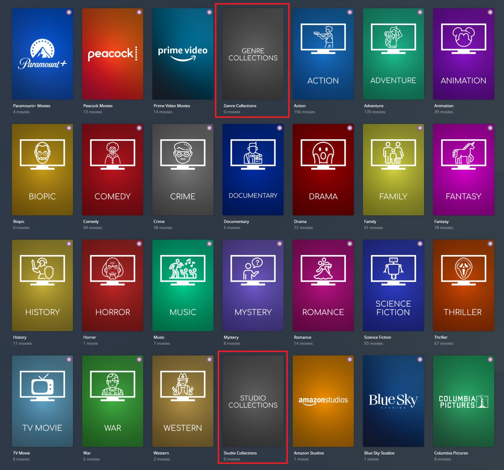

# Configuring Collection Defaults

There are many Default Collection Files built into Kometa itself which offer an easy-to-use and customizable set of Collections 
that the user can achieve without having to worry about creating the files that makes the collections possible.

This is the simplest way to create Collections using Kometa.



## Configurations

To run a default Kometa Collection File you can simply add it to your `collection_files` using `default` like so:

```yaml
libraries:
  Movies:
    collection_files:
      - default: actor
      - default: genre
```

## Separators

Most Metadata Files use separators to denote different sections of collection like actor collections vs studio collections.

**Chart Separator and Award Separator each have their own file, while the other Separators are part of their respective files.**

??? tip "Click to expand to see an example of Separators."

    

### Library on/off

Chart Separators are turned On by default (except `seasonal`), to turn the Separators On/Off on a per Library basis.

```yaml
libraries:
  LIBRARYNAME:
    template_variables:
      use_separator: false
    collection_files:
      - default: actor
      - default: genre
```

## Collection section order

All Default Collection Files have a `collection_section` attribute. These attributes determine the order of the various sections and can be set by [customizing your config](#customizing-configs).

For example: `collection_section: 01` translates to `sort_title: "!<<collection_section>><<pre>><<order_<<key>>>><<sort>>"` and so for `genre` if you have a `Fantasy` collection, plex is going to show `!06_Fantasy`

This is the default Kometa collection ordering:

<div class="collection-order-grid" markdown="1">

<div markdown="1">

| Section | Collections |
|:--------|:------------|
| `000` | `seasonal` |
| `010` | `basic` |
| `020` | `anilist`, `imdb`, `letterboxd`, `myanimelist`, `other_chart`, `tautulli`, `tracearr`, `tmdb` |
| `030` | `streaming` |
| `040` | `universe` |
| `050` | `network` |
| `060` | `genre` |
| `070` | `studio` |
| `080` | `country` |
| `081` | `region` |
| `082` | `continent` |
| `085` | `based` |
| `090` | `audio_language` |
| `095` | `subtitle_language` |

</div>

<div markdown="1">

| Section | Collections |
|:--------|:------------|
| `100` | `decade` |
| `105` | `year` |
| `110` | `content_rating_us`, `content_rating_uk`, `content_rating_de`, `content_rating_mal`, `content_rating_cs` |
| `120` | `resolution` |
| `125` | `aspect` |
| `130` | `bafta`, `berlinale`, `cannes`, `cesar`, `choice`, `emmy`, `golden`, `oscars`, `spirit`, `nfr`, `pca`, `razzie`, `sundance`, `tiff`, `venice` |
| `140` | `actor` |
| `150` | `director` |
| `160` | `producer` |
| `170` | `writer` |

</div>

</div>

## Customizing configs

Configs can be customized using the `template_variables` attribute when calling the file. These `template_variables` 
will be given to every template call in the file which allows them to affect how that file runs.

This example disables two keys, which will prevent those collections from being created. It also sets the visibility of one of the keys so that it is visible on the library tab, 
the server owner's home screen and shared user's home screens (assuming the server owner and/or the shared users have the library pinned to their home screen).

```yaml
libraries:
  TV Shows:
    collection_files:
      - default: imdb
        template_variables:
          use_popular: false
          use_lowest: false
          visible_library_top: true
          visible_home_top: true
          visible_shared_top: true
```

Each file has a page on the wiki showing the available `template_variables` for each file. For example the default`default: genre` has a page [here](../both/genre.md).

**In addition to the defined `template_variables` almost all default Metadata Files have access to the [Shared Variables](../shared.md).**

### Examples

For example if you want yearly oscar collections that go back 10 years instead of 5 all of which gets sent to radarr use the `data` and `radarr_add_missing` Template Variables.

```yaml
libraries:
  Movies:
    collection_files:
      - default: oscars
        template_variables:
          radarr_add_missing: true
          data:
            starting: latest-10
            ending: latest
```

Or maybe you want to change the number of actor collections made using default: actor.

```yaml
libraries:
  Movies:
    overlay_files:
      - default: actor
        template_variables:
          collection_mode: hide
          data:
            depth: 5
            limit: 50
```

Or maybe you want to change the collection sort order of the genre collections using default: genre.

```yaml
libraries:
  Movies:
    collection_files:
      - default: genre
        template_variables:
          collection_section: 11
```

Or maybe you want to disable separators globally per library.

```yaml
libraries:
  LIBRARYNAME:
    template_variables:
      use_separator: false
    collection_files:
      - ...
```

Alternatively it can be turned off individually per git file:

```yaml
libraries:
  LIBRARYNAME:
    collection_files:
      - default: <file1>    # separator is disabled
        template_variables:
          use_separator: false
      - default: <file2>    # separator is enabled by default
      - default: <file3>    # separator is disabled
        template_variables:
          use_separator: false
```


