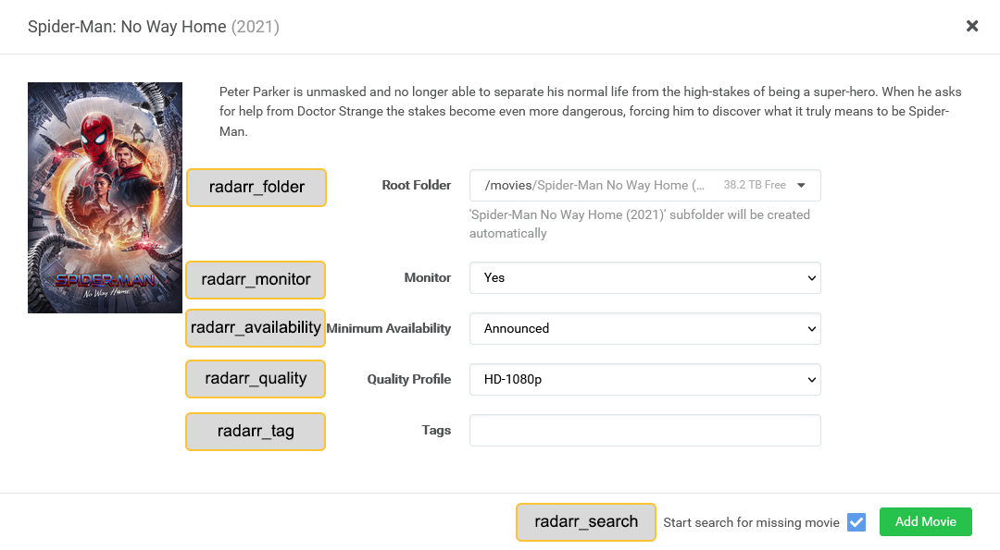
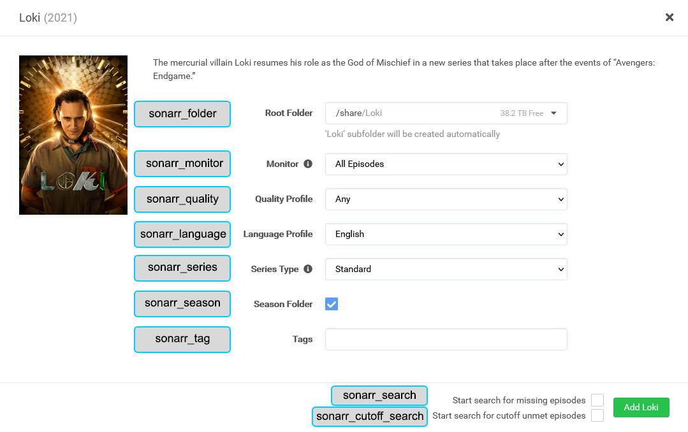

---
hide:
  - tags
tags:
  - radarr_add_missing
  - radarr_add_existing
  - radarr_upgrade_existing
  - radarr_monitor_existing
  - radarr_ignore_cache
  - radarr_folder
  - radarr_root_folder_path
  - radarr_monitor
  - radarr_availability
  - radarr_minimum_availability
  - radarr_quality
  - radarr_quality_profile
  - radarr_tag
  - radarr_tags
  - radarr_search
  - item_radarr_tag
  - item_radarr_tag.remove
  - item_radarr_tag.sync
  - sonarr_add_missing
  - sonarr_add_existing
  - seerr_add_missing
  - seerr_add_existing
  - seerr_instance
  - seerr_overrides
  - sonarr_upgrade_existing
  - sonarr_monitor_existing
  - sonarr_ignore_cache
  - sonarr_folder
  - sonarr_root_folder_path
  - sonarr_monitor
  - sonarr_quality
  - sonarr_quality_profile
  - sonarr_language
  - sonarr_language_profile
  - sonarr_series
  - sonarr_series_type
  - sonarr_season
  - sonarr_season_folder
  - sonarr_tag
  - sonarr_tags
  - sonarr_search
  - sonarr_cutoff_search
  - item_sonarr_tag
  - item_sonarr_tag.remove
  - item_sonarr_tag.sync
---

# Radarr, Sonarr, and Seerr Options

Control media additions, requests, and tag updates for an individual collection
or playlist definition. Put these options beside a builder, rather than inside
its dictionary. For source selection, see the
[Radarr](builders/radarr/index.md) and [Sonarr](builders/sonarr/index.md) builders.

!!! warning "Configure the service first"

    Configure [Radarr](../config/radarr.md), [Sonarr](../config/sonarr.md), or
    [Seerr](../config/seerr.md) globally or for the library before using its
    definition options. Radarr/Sonarr values inherit their global/library
    configuration unless overridden here.

## Adding to arr

| Option | Selects for addition |
|:-------|:---------------------|
| `radarr_add_missing`, `sonarr_add_missing` | Builder results missing from Plex |
| `radarr_add_existing`, `sonarr_add_existing` | Builder results already in Plex but not in Radarr/Sonarr |

<span id="arr-add-missing"></span>
<span id="arr-add-existing"></span>

Missing additions help acquire unavailable media. Existing additions register
media you already have. When Plex and Radarr/Sonarr see different filesystem
paths, set `plex_path` with `radarr_path` or `sonarr_path` in the corresponding
service configuration; those mappings are not definition-level options here.

## Shared Radarr/Sonarr overrides

All options in this table are booleans. Use unquoted `true` or `false` to override
the corresponding service setting for this definition.

| Radarr option | Sonarr option | Purpose |
|:--------------|:--------------|:--------|
| `radarr_add_missing` | `sonarr_add_missing` | Add missing builder results |
| `radarr_add_existing` | `sonarr_add_existing` | Add existing Plex media to the service |
| `radarr_upgrade_existing` | `sonarr_upgrade_existing` | Apply the definition's quality profile to existing records |
| `radarr_monitor_existing` | `sonarr_monitor_existing` | Apply monitoring settings to existing records |
| `radarr_ignore_cache` | `sonarr_ignore_cache` | Ignore Kometa's cache when adding items |
| `radarr_search` | `sonarr_search` | Search when adding media |

### Missing movies

Selects the top 20 popular TMDb movies and enables missing-movie additions to
Radarr. `true` is a boolean, while `20` is the builder's integer result count.
The root folder and profile strings must match your Radarr configuration.

```yaml
collections:
  Popular Movies to Add:
    tmdb_popular: 20
    radarr_add_missing: true
    radarr_root_folder_path: /movies
    radarr_quality_profile: HD-1080p
    radarr_search: true
```

## Radarr options {#radarr-definition-settings}

| Attribute | Value | Purpose |
|:----------|:------|:--------|
| `radarr_root_folder_path` | Folder path string | Root folder for additions |
| `radarr_monitor` | Boolean | Monitor newly added movies |
| `radarr_minimum_availability` | `announced`, `cinemas`, `released`, `db` | Override the service's `availability` setting |
| `radarr_quality_profile` | Radarr quality profile | Override `quality_profile` |
| `radarr_tags` | YAML list or comma-separated tag string | Override the service's `tag` setting |

### Radarr add settings

These correspond to the options available when adding a movie in Radarr.

??? info "Radarr add screen"

    

## Sonarr options {#sonarr-definition-settings}

| Attribute | Value | Purpose |
|:----------|:------|:--------|
| `sonarr_root_folder_path` | Folder path string | Root folder for additions |
| `sonarr_monitor` | `all`, `future`, `missing`, `existing`, `pilot`, `first`, `latest`, `none` | Episode monitoring policy |
| `sonarr_quality_profile` | Sonarr quality profile | Override `quality_profile` |
| `sonarr_language_profile` | Sonarr language profile | Override `language_profile` |
| `sonarr_series_type` | `standard`, `daily`, `anime` | Series type for additions |
| `sonarr_season_folder` | Boolean | Use season folders |
| `sonarr_tags` | YAML list or comma-separated tag string | Override the service's `tag` setting |
| `sonarr_cutoff_search` | Boolean | Search for episodes with an unmet quality cutoff |

Use the exact profile names, including spaces and capitalization, from your
service configuration.

### Sonarr add settings

Selects 10 popular shows, enables missing-show additions, monitors future episodes,
and uses season folders. `future` is a monitoring string, not a boolean. Tags are
strings in a YAML list; replace paths and profiles with your own values.

```yaml
collections:
  Popular Shows to Add:
    tmdb_popular: 10
    sonarr_add_missing: true
    sonarr_root_folder_path: /tv
    sonarr_quality_profile: HD-1080p
    sonarr_monitor: future
    sonarr_series_type: standard
    sonarr_season_folder: true
    sonarr_tags:
      - kometa
      - popular
```

??? info "Sonarr add screen"

    

## Arr edit settings

These options affect items found by the builders that already have a record in
Radarr/Sonarr. They differ from `radarr_tags` / `sonarr_tags`, which override the
service's addition settings. Values accept a YAML list or comma-separated string.

| Radarr option | Sonarr option | Effect |
|:--------------|:--------------|:-------|
| `item_radarr_tag` | `item_sonarr_tag` | Append the supplied tags |
| `item_radarr_tag.remove` | `item_sonarr_tag.remove` | Remove the supplied tags |
| `item_radarr_tag.sync` | `item_sonarr_tag.sync` | Replace the existing tag set with the supplied tags |

=== "Append"

    Finds library movies tracked by Radarr and appends the `kometa` and
    `reviewed` tags to their Radarr records, retaining other existing tags.

    ```yaml
    collections:
      Tagged Radarr Movies:
        radarr_all: true
        item_radarr_tag:
          - kometa
          - reviewed
    ```

=== "Remove"

    Removes `old-tag` from Sonarr records for the selected series. It does not
    remove the series or its other tags.

    ```yaml
    collections:
      Update Sonarr Tags:
        sonarr_all: true
        item_sonarr_tag.remove: old-tag
    ```

=== "Synchronize"

    Sets selected movies' Radarr tags to exactly `kometa` and `curated`.
    Other existing tags are removed; the quoted value is a comma-separated string.

    ```yaml
    collections:
      Curated Radarr Tags:
        radarr_taglist: curated
        item_radarr_tag.sync: "kometa,curated"
    ```

## Seerr options {#seerr-definition-settings}

Seerr routes movie/show requests through its configured Radarr and Sonarr servers.
Its request options are independent of direct Radarr/Sonarr additions: enabling
both routes also sends additions directly to those services.

| Attribute | Value | Purpose / default |
|:----------|:------|:------------------|
| `seerr_add_missing` | Boolean | Request media missing from Plex |
| `seerr_add_existing` | Boolean | Request media already in Plex, such as a 4K version |
| `seerr_instance` | `standard`, `4k`, `both` | Request tier; default `standard` |
| `seerr_overrides` | Dictionary with `standard` and/or `4k` | Per-tier server, profile, and root-folder overrides |

Each override tier can contain `server_id`, `quality_profile` (ID or name), and
`root_folder`. Unset values use Seerr's defaults for that tier; configure regular
and 4K servers in Seerr. `both` makes separate tier requests, so one tier's failure
or duplicate does not prevent the other from being attempted. Shows request all
seasons. See [Seerr configuration](../config/seerr.md) for connection settings.

=== "Both tiers"

    Requests missing popular movies in both standard and 4K tiers. The integer
    `20` limits the source builder; `true` enables requests and `both` is a tier string.

    ```yaml
    collections:
      Popular Movie Requests:
        tmdb_popular: 20
        seerr_add_missing: true
        seerr_instance: both
    ```

=== "Existing media and nested overrides"

    Requests a 4K version of movies already in Plex. The nested dictionary
    overrides only the 4K tier. Replace server ID, quality profile ID, and root
    folder with values from your Seerr setup.

    ```yaml
    collections:
      Existing Movies in 4K:
        plex_all: true
        seerr_add_existing: true
        seerr_instance: 4k
        seerr_overrides:
          4k:
            server_id: 2
            quality_profile: 4
            root_folder: /media/movies-4k
    ```
