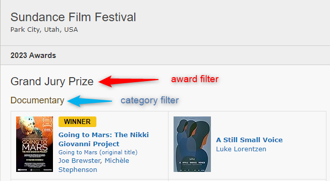

# IMDb Builders

Find movies and shows using [IMDb](https://www.imdb.com/). Select titles by ID,
follow a chart or list, or collect award entries. For detailed filters, use
[Advanced Search](search.md).

## Choose a builder

| Builder | Finds | Supports | Playlists / custom sort |
|:--------|:------|:---------|:-----------------------|
| [`imdb_id`](#imdb-id) | Specific titles | Movies, shows | No |
| [`imdb_chart`](#imdb-chart) | Chart entries | Movies, shows | Yes |
| [`imdb_list`](#imdb-list) | Titles in a list | Movies, shows | Yes |
| [`imdb_watchlist`](#imdb-watchlist) | Titles in a user's watchlist | Movies, shows | Yes |
| [`imdb_award`](#imdb-award) | Award nominees or winners | Movies, shows | No |
| [`imdb_search`](search.md) | Titles matching search filters | Movies, shows | Yes |

For charts, lists, watchlists, and searches, use `collection_order: custom` to
preserve the builder's order and `sync_mode: sync` to keep membership synchronized.

## Title IDs {#imdb-id}

Use title IDs beginning with `tt`, found in URLs such as `imdb.com/title/tt0458290/`.
Multiple IDs can be supplied as a YAML list or comma-separated string.

<span id="example-imdb-id-builders"></span>

This collection includes the two specified Star Wars animated shows.

```yaml
collections:
  Star Wars (Animated Shows):
    imdb_id:
      - tt0458290
      - tt2930604
```

## Charts {#imdb-chart}

Choose a chart value below. Multiple values are supported as a YAML list or
comma-separated string; supported media depends on the chart.

| Value | Chart | Supports |
|:------|:------|:---------|
| `box_office` | [Box Office](https://www.imdb.com/chart/boxoffice) | Movies |
| `popular_movies` | [Most Popular Movies](https://www.imdb.com/chart/moviemeter) | Movies |
| `top_movies` | [Top 250 Movies](https://www.imdb.com/chart/top) | Movies |
| `top_english` | [Top Rated English Movies](https://www.imdb.com/chart/top-english-movies) | Movies |
| `popular_shows` | [Most Popular TV Shows](https://www.imdb.com/chart/tvmeter) | Shows |
| `top_shows` | [Top 250 TV Shows](https://www.imdb.com/chart/toptv) | Shows |
| `lowest_rated` | [Lowest Rated Movies](https://www.imdb.com/chart/bottom) | Movies |
| `top_indian` | [Top Rated Indian Movies](https://www.imdb.com/india/top-rated-indian-movies/) | Movies |
| `top_tamil` | [Top Rated Tamil Movies](https://www.imdb.com/india/top-rated-tamil-movies/) | Movies |
| `top_telugu` | [Top Rated Telugu Movies](https://www.imdb.com/india/top-rated-telugu-movies/) | Movies |
| `top_malayalam` | [Top Rated Malayalam Movies](https://www.imdb.com/india/top-rated-malayalam-movies/) | Movies |
| `trending_india` | [Trending Indian Movies & Shows](https://www.imdb.com/india/upcoming/) | Movies, shows |
| `trending_tamil` | [Trending Tamil Movies](https://www.imdb.com/india/tamil/) | Movies |
| `trending_telugu` | [Trending Telugu Movies](https://www.imdb.com/india/telugu/) | Movies |

<span id="example-imdb-chart-builders"></span>

This collection follows IMDb's Top 250 Movies in chart order, updating membership
as the chart changes.

```yaml
collections:
  IMDb Top 250 Movies:
    imdb_chart: top_movies
    collection_order: custom
    sync_mode: sync
```

## Lists and watchlists

Use `imdb_list` for a list or `imdb_watchlist` for a user's watchlist. Both accept
the shared options below. To combine sources, use a **YAML list of dictionaries**,
rather than a comma-separated string.

| Option | Value | Purpose |
|:-------|:------|:--------|
| `limit` | Integer, 0 or greater | Maximum items per source; default `0` means all. |
| `sort_by` | Sort option | Default `custom.asc`; see fields below. |

For `sort_by`, append `.asc` or `.desc` to one of these fields:
`custom`, `title`, `rating`, `popularity`, `votes`, `release`, `runtime`, or `added`.
For example, `rating.desc` selects highest-rated titles first.

### Lists {#imdb-list}

The required `list_id` is the `ls` ID from the list URL, such as
`imdb.com/list/ls006405458/`. Search and filmosearch URLs belong in
[Advanced Search](search.md), rather than `imdb_list`.

<span id="example-imdb-list-builders"></span>

=== "One list"

    Selects up to 100 titles from this James Bond list, highest rated first.
    The limit is an integer and the sort option is a string.

    ```yaml
    collections:
      James Bond:
        imdb_list:
          list_id: ls006405458
          limit: 100
          sort_by: rating.desc
        collection_order: custom
        sync_mode: sync
    ```

=== "Multiple lists"

    Combines up to 10 titles from each Christmas list, selecting the highest-rated
    entries from each source. The resulting collection is displayed alphabetically.

    ```yaml
    collections:
      Christmas:
        imdb_list:
          - list_id: ls025976544
            limit: 10
            sort_by: rating.desc
          - list_id: ls003863000
            limit: 10
            sort_by: rating.desc
        collection_order: alpha
        sync_mode: sync
    ```

### Watchlists {#imdb-watchlist}

The required `user_id` accepts a legacy `ur` ID, a newer `p.` ID, or a full watchlist
URL such as `https://www.imdb.com/user/ur64054558/watchlist`.

<span id="example-imdb-watchlist-builders"></span>

This example combines up to 100 titles from each person's watchlist, selecting
highest-rated titles first. It demonstrates both supported user ID formats.

```yaml
collections:
  Friends' Watchlists:
    imdb_watchlist:
      - user_id: ur64054558
        sort_by: rating.desc
        limit: 100
      - user_id: p.fl6ssgsolkgcctcuxapgh6chsa
        sort_by: rating.desc
        limit: 100
    collection_order: custom
    sync_mode: sync
```

## Awards {#imdb-award}

Find titles nominated for or winning an award at an [IMDb event](https://www.imdb.com/event/).

| Option | Value | Purpose |
|:-------|:------|:--------|
| `event_id` | Event ID, required | The `ev` ID from the event URL, such as `ev0000003`. |
| `event_year` | Year or year selection, required | A year, `all`, negative relative year (`-10`), list of years, or range such as `2000-2009`, `2000-current`, or `-30-current`. |
| `award_filter` | String or YAML list | Award heading on the event page. |
| `category_filter` | String or YAML list | Category heading on the event page. |
| `winning` | Boolean | `true` selects winners; default `false` includes nominees. |

Award and category filters can be combined. For multiple headings, use YAML lists,
rather than comma-separated strings. Choose years from the event's history.

??? info "Finding award and category headings"

    In this example, "Grand Jury Prize" is the award and "Documentary" is the category.

    

??? info "Events supporting multiple years"

    Multiple-year selections are supported only for the event IDs listed here:

    ```yaml
    
    ```

<span id="example-imdb-award-builders"></span>

=== "Winners (boolean)"

    Includes winners across Academy Award categories for the 2023 event.
    `winning: true` is an unquoted boolean; `event_year` is an integer.

    ```yaml
    collections:
      Academy Award Winners 2023:
        imdb_award:
          event_id: ev0000003
          event_year: 2023
          winning: true
    ```

=== "Category (string)"

    Includes the 2023 Best Picture nominees, including the winner. The category
    heading is a string; omitting `winning` keeps its default of `false`.

    ```yaml
    collections:
      Academy Award Best Picture Nominees 2023:
        imdb_award:
          event_id: ev0000003
          event_year: 2023
          category_filter: "Best Motion Picture of the Year"
    ```
