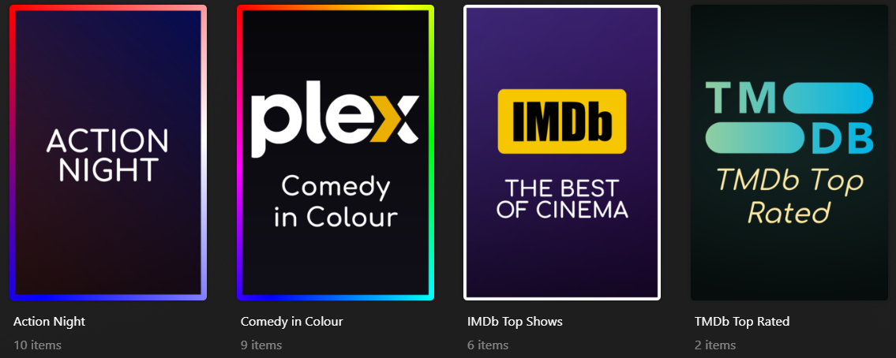

---
search:
  boost: 3
hide:
  - tags
tags:
  - tmdb_person
  - tmdb_person_offset
  - sort_title
  - content_rating
  - label
  - label.remove
  - label.sync
  - collection_mode
  - collection_order
  - collection_filtering
  - visible_library
  - visible_home
  - visible_shared
  - url_theme
  - file_theme
  - url_poster
  - tmdb_poster
  - tmdb_list_poster
  - tmdb_profile
  - tvdb_poster
  - tvdb_list_poster
  - file_poster
  - url_background
  - tmdb_background
  - tvdb_background
  - file_background
  - url_logo
  - file_logo
  - url_square_art
  - file_square_art
  - addon_offset
  - item_label
  - item_label.remove
  - item_label.sync
  - item_genre
  - item_genre.remove
  - item_genre.sync
  - item_edition
  - non_item_remove_label
  - item_lock_poster
  - item_lock_background
  - item_lock_square_art
  - item_lock_title
  - item_assets
  - item_refresh
  - item_refresh_delay
  - item_tmdb_season_titles
  - item_episode_sorting
  - item_keep_episodes
  - item_delete_episodes
  - item_season_display
  - item_episode_ordering
  - item_metadata_language
  - item_use_original_title
  - item_credits_detection
  - item_audio_language
  - item_subtitle_language
  - item_subtitle_mode
  - item_analyze
---

# Metadata Updates

Update the collection or playlist itself, or update the Plex media items selected
by its builders. Put metadata options beside the builder, not inside its dictionary.

## Choose what to update

| Target | Options | Playlist support |
|:-------|:--------|:-----------------|
| Collection display and visibility | `collection_*`, `sort_title`, `content_rating`, labels, themes | No |
| Person metadata | `tmdb_person` | Yes |
| Summary and artwork | Text, file, URL, and external metadata sources below | Yes |
| Media items inside a collection | `item_*`, `non_item_remove_label` | No; overlays also unsupported |

For example, `label` changes the collection's labels, while `item_label` changes
labels on the selected media. These options update metadata; they do not replace
a builder that selects the items.

## Collection display

| Attribute | Value / effect |
|:----------|:---------------|
| `sort_title` | Display-sort string; a leading `+` promotes a collection and `~` demotes it |
| `content_rating` | Content-rating text |
| `collection_mode` | `default`: library default; `hide`: hide collection; `hide_items`: hide its items; `show_items`: show collection and items |
| `collection_order` | `release`, `alpha`, `custom.asc`, `custom.desc`, or a [Plex search sort](builders/plex/search.md#plex-sort-options); manual collections only |
| `collection_filtering` | `admin`: server admin's view; `user`: current viewer's view; smart collections only |

Custom ascending/descending builder ordering requires **one builder** in the
collection. Smart collections use their own filter sorting instead.

### Labels

Values below are comma-separated label strings. Append and remove preserve other
labels; synchronize replaces the collection's label set.

| Attribute | Effect |
|:----------|:-------|
| `label` | Append labels |
| `label.remove` | Remove the named labels |
| `label.sync` | Replace labels with the supplied set; blank removes all labels |

### Visibility and themes

`visible_library`, `visible_home`, and `visible_shared` require **Plex Pass**.
Each accepts `true`, `false`, or a [schedule](../config/schedule.md) to control
visibility on the Library Recommended tab, your Home tab, or shared users' Home
respectively. The values can therefore be booleans or schedule strings.

`file_theme` takes a local MP3 path; `url_theme` takes an MP3 URL. Both change the
collection's theme.

## TMDb people

`tmdb_person` takes a TMDb person ID or actor name, as a YAML list or comma-separated
string for multiple people. Names use the first TMDb search result. The **first
person** supplies the biography and profile image, and the specified people can
also be used in [Plex searches](builders/plex/search.md#tmdb-people).

The other collection display, label, theme, and offset options are collection-only.

`tmdb_person_offset` offsets the selected search results. Its default is `0`;
use a positive number to change the offset.

## Summaries {#summary-collectionplaylist-metadata-updates}

All summary sources below work with collections and playlists.

| Attribute | Value / source |
|:----------|:---------------|
| `summary` | Summary text |
| `letterboxd_description` | Letterboxd list URL; uses its description |
| `tmdb_biography` | TMDb person ID; uses the biography |
| `tmdb_description` | TMDb list ID; uses its description |
| `tmdb_summary` | TMDb movie/collection ID for movie libraries, or show ID for show libraries |
| `tvdb_description` | TVDb list URL; uses its description |
| `tvdb_summary` | TVDb movie/show ID or URL, according to library type |

## Artwork sources

All artwork sources below work with collections and playlists. TMDb movie-library
sources accept movie/collection IDs; show-library sources use show IDs. TVDb
sources accept the corresponding movie/show ID or URL.

<span id="poster-collectionplaylist-metadata-updates"></span>
<span id="background-collectionplaylist-metadata-updates"></span>

| Source | Poster option | Background option | Value |
|:-------|:--------------|:------------------|:------|
| Public image URL | `url_poster` | `url_background` | Image URL |
| Local image | `file_poster` | `file_background` | File path |
| TMDb title | `tmdb_poster` | `tmdb_background` | TMDb movie/show/collection ID |
| TVDb title | `tvdb_poster` | `tvdb_background` | TVDb movie/show ID or URL |
| TMDb list | `tmdb_list_poster` | - | TMDb list ID |
| TVDb list | `tvdb_list_poster` | - | TVDb list URL |
| TMDb person | `tmdb_profile` | - | TMDb person ID |

<span id="logo-collectionplaylist-metadata-updates"></span>
<span id="square-art-collectionplaylist-metadata-updates"></span>

| Artwork | Public image URL | Local file |
|:--------|:-----------------|:-----------|
| Logo | `url_logo` | `file_logo` |
| Square art, used by some Plex clients | `url_square_art` | `file_square_art` |

### Generated posters

Use `kometa_poster` to generate a faded colour background with centred text and an optional image above it:

```yaml
collections:
  Test:
    plex_all: true
    kometa_poster:
      text: "This is a Test"
      style: dual
  Pixar:
    plex_all: true
    kometa_poster:
      image: config/assets/pixar.svg
      style: dual
```

`kometa_poster: true` or an empty mapping (`kometa_poster: {}`) uses `<<collection_name>>` as its text, resolving to the collection name. Set `text: ""` to hide text.

Images accept local paths or direct HTTP(S) image URLs, including SVG. When `image` is omitted, chart/list builders use a matching logo from the [Default-Images chart logos](https://github.com/Kometa-Team/Default-Images/tree/master/chart/logos).


Set `image: null` to suppress the automatic logo, or set an explicit image to override it. If an automatic logo cannot be downloaded, the poster is generated without it.

```yaml
collections:
  IMDb Top Movies:
    imdb_chart: top_movies
    kometa_poster:
      decoration: "bold, upper"
      style: dual
      # image omitted: automatically uses IMDb.png
```
Fonts accept bundled filenames or local paths.

Generated posters take priority over other poster sources, except assets when `prioritize_assets` is enabled.

| Attribute | Default | Description |
|:----------|:--------|:------------|
| `text` | `<<collection_name>>` | Caption |
| `image` | Builder logo when mapped | Local image path or direct image URL; `null` disables the automatic logo |
| `style` | `single` | `single`, `dual`, or colour families such as `dual(red:blue)` |
| `font` | `Comfortaa-Medium.ttf` | Bundled font filename or local path |
| `decoration` | None | Comma-separated `bold`, `italic`, `upper`, `lower`, `title`, `sentence`, `small_caps`, `underline`, `strike`, `outline`, `shadow` |
| `outline_color` | `"#000000"` | Named or hex colour used with `decoration: outline` |
| `outline_width` | `2` | Outline thickness in pixels (0?100); used with `decoration: outline` |
| `shadow_color` | `"#000000"` | Named or hex colour used with `decoration: shadow` |
| `shadow_offset` | `4` | Shadow offset down and right in pixels (0?100); used with `decoration: shadow` |
| `font_size` | `120` | Initial font size in pixels; text may shrink to fit |
| `border_width` | `0` | Border thickness in pixels, drawn inwards over the artwork; `0` disables the border |
| `border_color` | `"#FFFFFF"` | Colour name or hex colour (e.g. `white`), a list (`[red, white, blue]`) or comma-separated string (`red, white, blue`) for a smooth clockwise gradient that blends back to the first colour, or `rainbow` for a smooth spectrum around the border |
| `text_color` | `"#FFFFFF"` | Hex text colour |
| `color` | Automatic | Hex background colour for `single` style |
| `fade` | Automatic | `top`, `bottom`, or `middle` |
| `text_width` | `0.75` | Maximum text width relative to canvas width |
| `image_width`, `image_height` | `0.85`, `0.45` | Maximum image dimensions relative to canvas dimensions |
| `image_text_gap` | `0.05` | Gap relative to canvas height |
| `top_margin`, `bottom_margin` | `0.05`, `0.05` | Margins relative to canvas height |

Decorations apply after placeholders are substituted. Capitalisation changes run in the listed order. For example, `decoration: "bold, italic, upper"` uses bold italic uppercase text. A matching font face is selected from the same family beside the font file; missing bold/italic faces are synthesised.

`underline` and `strike` draw a line beneath or through each caption line. `sentence` lowercases
the caption and capitalises the start of each sentence and explicit line. `small_caps` renders
lowercase letters as smaller uppercase letters and keeps existing capitals full size. Combine
it with `lower` first if you want every letter small, or leave the original capitalisation intact
for a mix of sizes.

`outline` draws a coloured stroke around filled text, and `shadow` adds a shadow down and right.
Their colour and size attributes only take effect when the matching decoration is selected.
All effects can be combined:

```yaml
kometa_poster:
  text: "Movie Night"
  decoration: "small_caps, underline, outline, shadow"
  outline_color: navy
  outline_width: 3
  shadow_color: "#000000"
  shadow_offset: 6
```

Layout values are decimal fractions (`0.75` means 75%). Text width and image dimensions must be greater than zero and at most one. Gaps and margins may be zero and must be less than one; margins must total less than one.
Images preserve aspect ratio; text wraps and content shrinks to fit. Unchanged settings produce stable artwork across runs.
Playlists default to a square 1000 pixel canvas. Colour families are red, orange, yellow, lime, green, teal, cyan, blue, indigo, purple, pink and magenta.

#### Borders

Set `border_width` to a positive integer in pixels to enable a border. The border is drawn
inwards over the artwork, so the canvas dimensions stay the same. `border_color` defaults
to white and accepts:

- A named colour: `border_color: white`.
- A hex colour: `border_color: "#FFD700"`. Quote hex colours so YAML does not treat them as comments.
- A YAML list: `border_color: [red, white, blue]`.
- A comma-separated string: `border_color: red, white, blue`.
- A full spectrum: `border_color: rainbow`.

Multiple colours blend smoothly clockwise around the border in the order given, including
from the last colour back to the first. `rainbow` creates a continuous spectrum.
Set `border_width: 0` to disable the border.

#### Generated poster showcase

These four movie collection examples demonstrate different backgrounds, captions, layouts,
and borders. The IMDb example uses its automatic builder logo; the other three hide logos
for a text-focused design. Adjust the genre names to match your library.

```yaml
collections:
  IMDb Top Shows:
    imdb_chart: top_shows
    kometa_poster:
      text: "The best of cinema"
      style: dual(indigo:purple)
      decoration: "bold, upper"
      font_size: 110
      image_width: 0.65
      image_height: 0.30
      image_text_gap: 0.08
      border_width: 16
      border_color: white

  TMDb Top Rated:
    tmdb_top_rated: 50
    kometa_poster:
      style: single
      color: "#18332F"
      fade: middle
      font: Comfortaa-Medium.ttf
      font_size: 140
      decoration: "italic"
      text_color: "#FFE8A3"
      text_width: 0.80

  Action Night:
    plex_search:
      all:
        genre: Action
    kometa_poster:
      text: "<<collection_name>>"
      image: null
      style: dual(red:blue)
      fade: bottom
      decoration: "bold, upper"
      font_size: 150
      text_width: 0.70
      top_margin: 0.12
      bottom_margin: 0.12
      border_width: 30
      border_color: red, white, blue
      # Equivalent: border_color: [red, white, blue]

  Comedy in Colour:
    plex_search:
      all:
        genre: Comedy
    kometa_poster:
      text: "Comedy\nin Colour"
      style: single
      color: "#191724"
      fade: top
      decoration: bold
      font_size: 130
      text_color: "#FFFFFF"
      text_width: 0.85
      border_width: 28
      border_color: rainbow
```



### Asset lookup and source priority

When artwork is not specified, Kometa checks the
[asset directories](../kometa/guides/assets.md) for a folder matching the collection
or playlist name, or `name_mapping` when set.

| Artwork | Supported asset names | Standard priority, highest first |
|:--------|:----------------------|:---------------------------------|
| Poster | `poster.ext`, `cover.ext`, `default.ext`, `folder.ext`, `movie.ext` | `url_poster`, `file_poster`, `tmdb_poster`, `tvdb_poster`, assets, `tmdb_person`, `tmdb_collection_details`, other `_details` methods |
| Background | `background.ext`, `art.ext`, `backdrop.ext`, `fanart.ext` | `url_background`, `file_background`, `tmdb_background`, `tvdb_background`, assets |
| Logo | `logo.ext`, `clearlogo.ext` | `url_logo`, `file_logo`, assets |
| Square art | `square.ext`, `square_art.ext`, `squareArt.ext`, `backgroundSquare.ext` | `url_square_art`, `file_square_art`, assets |

`prioritize_assets` moves assets to the top of these priority lists.

??? info "Person-image validation and fallback"

    People-Images URLs are checked before selection. Missing images log a warning
    and fall back to the next poster source, such as the profile from `tmdb_person`.
    Existing images retain their usual priority. Successful and missing-image
    checks are cached for the run and checked again next run; each distinct URL
    requires a HEAD request. Rate-limit, server, and network failures also fall
    back, but are logged as validation failures rather than confirmed missing
    images, and temporary failures are not cached.

## Collection examples

=== "Strings and collection labels"

    Selects Action movies, assigns a literal summary, and appends two labels to
    the collection. The comma-separated `label` string does not label the movies.

    ```yaml
    collections:
      Action Picks:
        plex_search:
          all:
            genre: Action
        summary: "Action movies for movie night."
        label: "curated,movie-night"
        sort_title: +Action Picks
    ```

=== "Person metadata"

    Collects Robin Williams' acting credits and uses his TMDb biography/profile
    for the collection. The numeric person ID is used by both the builder and
    metadata option for different purposes.

    ```yaml
    collections:
      Robin Williams:
        tmdb_actor: 2157
        tmdb_person: 2157
    ```

=== "Artwork and visibility"

    Uses local poster and background files and promotes the collection to your
    Home tab. `true` is an unquoted boolean and Home visibility requires Plex Pass.
    Replace the file paths with your own images.

    ```yaml
    collections:
      Featured Movies:
        plex_search:
          all:
            added: 30
        file_poster: config/assets/featured/poster.jpg
        file_background: config/assets/featured/background.jpg
        visible_home: true
    ```

## Media item updates {#item-metadata-updates}

!!! important "Collection items only"

    Item updates affect the selected media, rather than the collection itself.
    They are not supported for playlists or overlays. Most options below apply
    to movies/shows; show-only and Music exceptions are noted explicitly.

### Maintenance and artwork

| Attribute | Effect | Values / default |
|:----------|:-------|:-----------------|
| `item_analyze` | Run Plex Analyze | `true`, **`false`** |
| `item_assets` | Look for assets for each selected movie/show | `true`, **`false`** |
| `item_refresh` | Refresh item metadata | `true`, **`false`** |
| `item_refresh_delay` | Wait between metadata refreshes | Positive delay; default **`0`** |
| `item_lock_background` | Lock or unlock background | `true`, `false`, or leave blank |
| `item_lock_poster` | Lock or unlock poster | `true`, `false`, or leave blank |
| `item_lock_square_art` | Lock or unlock square art | `true`, `false`, or leave blank |
| `item_lock_title` | Lock or unlock title | `true`, `false`, or leave blank |

### Ratings and edition

| Attribute | Effect | Values / default |
|:----------|:-------|:-----------------|
| `item_audience_rating` | Set audience rating | Number between 0.0 and 10.0 or blank to erase the rating |
| `item_critic_rating` | Set critic rating | Number between 0.0 and 10.0 or blank to erase the rating |
| `item_user_rating` | Set user rating | Number between 0.0 and 10.0 or blank to erase the rating |
| `item_edition` | Replace edition name | Edition name (e.g. `Extended`, `Director's Cut`) |

### Item labels and genres

Label updates support movies, shows, artists, albums, and tracks; `item.label` is
also accepted as an alias for `item_label`. Genres apply to movies/shows. Supply
comma-separated strings: the base option appends, `.remove` removes named values,
and `.sync` replaces the existing set.

| Attribute | Effect | Values / default |
|:----------|:-------|:-----------------|
| `item_label` | Append labels | Comma-separated string |
| `item_label.remove` | Remove named labels | Comma-separated string |
| `item_label.sync` | Replace label set | Comma-separated string |
| `non_item_remove_label` | Remove these labels from movies/shows outside the collection | Comma-separated string |
| `item_genre` | Append genres | Comma-separated string |
| `item_genre.remove` | Remove named genres | Comma-separated string |
| `item_genre.sync` | Replace genre set | Comma-separated string |

### Playback and metadata preferences

These preferences require the **Plex Movie or Plex Series agent**.

| Attribute | Effect | Values / default |
|:----------|:-------|:-----------------|
| `item_audio_language` | Preferred audio language | See [language values](#language-values) (also `en`) |
| `item_subtitle_language` | Preferred subtitle language | See [language values](#language-values) (also `en`) |
| `item_metadata_language` | Metadata language | See [language values](#language-values) (locale codes only) |
| `item_subtitle_mode` | Automatic subtitle selection mode | `default` (Account default), `manual` (Manually selected), `foreign` (Shown with foreign audio), `always` (Always enabled) |
| `item_use_original_title` | Use original title | `default` (Library default), `no`, `yes` |
| `item_credits_detection` | Credits-detection preference | `default` (Library default), `disabled` (Disabled) |

### Show and episode preferences

These options apply only to **show libraries**.

| Attribute | Effect | Values / default |
|:----------|:-------|:-----------------|
| `item_delete_episodes` | Automatic episode deletion policy | `never` (Never), `day` (After a day), `week` (After a week), `month` (After a month), `refresh` (On next refresh) |
| `item_episode_ordering` | Episode ordering source | `default` (Library default), `tmdb_aired`, `tvdb_aired`, `tvdb_dvd`, `tvdb_absolute` |
| `item_episode_sorting` | Episode display order | `default` (Library default), `oldest`, `newest` |
| `item_keep_episodes` | Episode retention policy | `all`, `5_latest`, `3_latest`, `latest`, `past_3`, `past_7`, `past_30` |
| `item_season_display` | Season display mode | `default` (Library default), `show`, `hide` |
| `item_tmdb_season_titles` | Use TMDb season titles | `true`, **`false`** |

### Language values

`item_audio_language` and `item_subtitle_language` accept `en` as well as the
following values. `item_metadata_language` uses the locale list below.

??? info "Language codes"

    `default`, `ar-SA`, `ca-ES`, `cs-CZ`, `da-DK`, `de-DE`, `el-GR`, `en-AU`, `en-CA`, `en-GB`, `en-US`, `es-ES`, `es-MX`, `et-EE`, `fa-IR`, `fi-FI`, `fr-CA`, `fr-FR`, `he-IL`, `hi-IN`, `hu-HU`, `id-ID`, `it-IT`, `ja-JP`, `ko-KR`, `lt-LT`, `lv-LV`, `nb-NO`, `nl-NL`, `pl-PL`, `pt-BR`, `pt-PT`, `ro-RO`, `ru-RU`, `sk-SK`, `sv-SE`, `th-TH`, `tr-TR`, `uk-UA`, `vi-VN`, `zh-CN`, `zh-HK`, `zh-TW`

## Item examples

=== "Append and clean up labels"

    Appends `action-pick` to the selected Action movies. `non_item_remove_label`
    removes that label from other movies/shows outside the collection, keeping
    it aligned with current membership without replacing unrelated labels.

    ```yaml
    collections:
      Action Picks:
        plex_search:
          all:
            genre: Action
        item_label: action-pick
        non_item_remove_label: action-pick
    ```

=== "Decimal rating"

    Assigns a user rating of 8.5 to every movie selected from the list. This sets
    an item field; it does not filter out movies with lower existing ratings.

    ```yaml
    collections:
      My Rated Picks:
        imdb_list:
          list_id: ls006405458
        item_user_rating: 8.5
    ```

=== "Blank rating"

    Clears the user rating on selected movies. A blank value erases the field,
    unlike a numeric zero, which is a rating value.

    ```yaml
    collections:
      Clear Ratings on Tagged Movies:
        plex_search:
          all:
            label: clear-rating
        item_user_rating:
    ```

=== "Show preferences"

    Changes selected shows' episode sorting to newest first and keeps all episodes.
    These are string-valued preferences, not playback-history filters. The show-only
    preference rules and agent requirements above still apply.

    ```yaml
    collections:
      Show Preferences:
        plex_all: true
        item_episode_sorting: newest
        item_keep_episodes: all
    ```

For deliberate line breaks, use a YAML literal block. Each line is preserved when wrapping the caption:

```yaml
kometa_poster:
  font_size: 80
  text: |-
    Movie
    night
    Something for everyone
```

Double-quoted text also supports `\n` escapes. A YAML formatter may rewrite these as a multiline scalar; the literal block above makes the intended breaks clearer.
