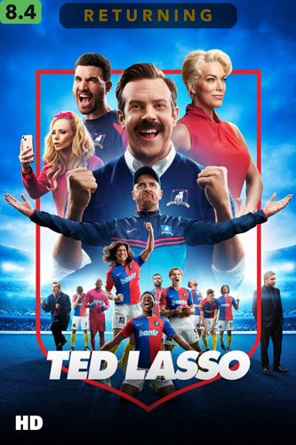
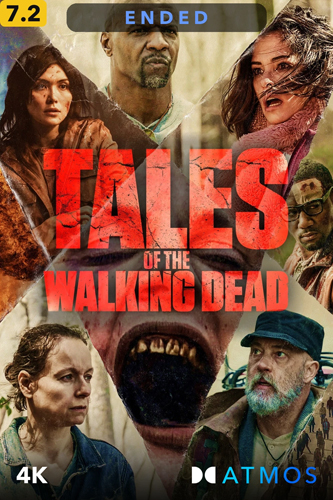
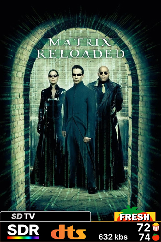
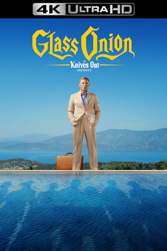
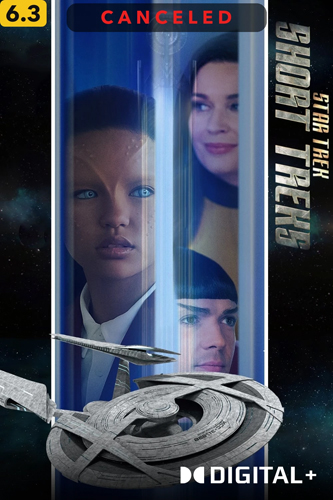
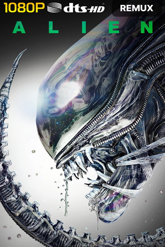
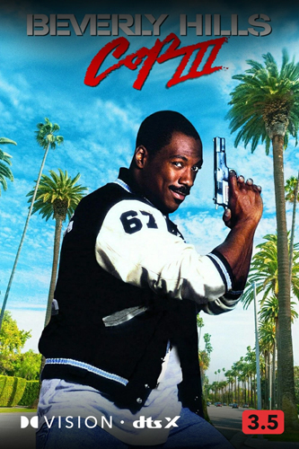
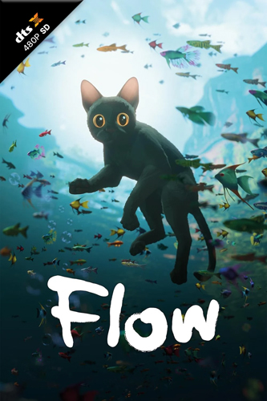

# Kometa

  

Organize and personalize your Plex libraries with automatic collections, poster overlays, playlists, and metadata updates. Use ready-made Defaults or write your own YAML definitions, drawing on services such as TMDb and IMDb.

## Where to start

-   :lucide-download: **Install Kometa**

    Set up Kometa and make your first run, with walkthroughs for local and Docker installations.

    [Get started](kometa/install/index.md)

-   :lucide-sparkles: **Use ready-made Defaults**

    Browse collections, overlays, and playlists you can add to your configuration.

    [Browse Defaults](defaults/guide.md#list-of-defaults-files)

-   :lucide-settings: **Create your own**

    Choose builders, filter their results, and define collections for your libraries.

    [Write collection files](files/collections.md)

-   :lucide-life-buoy: **Get help**

    Understand your logs and find the information needed to troubleshoot a run.

    [Read the logs guide](kometa/help.md) or [ask on Discord](https://kometa.wiki/en/latest/discord/).

## Your first setup

1. **[Install Kometa](kometa/install/index.md)** using the guide for your platform.
2. **[Configure your connections](config/overview.md)** with the URLs and credentials Kometa needs for Plex, TMDb, and your other services.
3. **[Add Defaults](defaults/guide.md)** or your own collection files, then **[run Kometa](kometa/environmental.md#run)** to apply them.

!!! tip "Using a NAS or Kubernetes?"

    The installation guide includes unRAID, Kubernetes, QNAP, and Synology paths. If you are new to Kometa, follow the [Docker walkthrough](kometa/install/index.md#path-docker) first to understand the configuration and collection files used by those setups.

## See what you can create

### Collections

Group movies and shows by streaming service, genre, actor, decade, awards, or popularity. For example, create an IMDb Top 250 collection or keep a recently released collection up to date.

  

    <figure>
      
    </figure>
    <figure>
      
    </figure>
    <figure>
      
    </figure>
    <figure>
      
    </figure>
    <figure>
      
    </figure>
    <figure>
      
    </figure>
    <figure>
      
    </figure>
    <figure>
      
    </figure>
    <figure>
      
    </figure>
    <figure>
      
    </figure>
    <figure>
      
    </figure>
    <figure>
      
    </figure>
    <figure>
      
    </figure>
    <figure>
      
    </figure>
    <figure>
      
    </figure>
    <figure>
      
    </figure>
    <figure>
      
    </figure>
    <figure>
      
    </figure>
    <figure>
      
    </figure>
    <figure>
      
    </figure>
    <figure>
      
    </figure>
    <figure>
      
    </figure>
    <figure>
      
    </figure>
    <figure>
      
    </figure>
    <figure>
      
    </figure>
    <figure>
      
    </figure>
  

<figcaption style="text-align: center; max-width: 100%; margin-top: 0.1rem;" >
  Collections created using the <a href="defaults/guide.md">Kometa Defaults</a>
</figcaption>

### Overlays

Add information such as ratings or resolution to your posters. Start with [Default overlays](defaults/overlays/usage.md) or use overlay files shared by the community.

  

    <figure>
      
    </figure>
    <figure>
      
    </figure>
    <figure>
      
    </figure>
    <figure>
      
    </figure>
    <figure>
      
    </figure>
    <figure>
      
    </figure>
    <figure>
      
    </figure>
    <figure>
      
    </figure>
    <figure>
      
    </figure>
    <figure>
      
    </figure>
    <figure>
      
    </figure>
    <figure>
      
    </figure>
    <figure>
      
    </figure>
    <figure>
      
    </figure>
    <figure>
      
    </figure>
    <figure>
      
    </figure>
    <figure>
      
    </figure>
    <figure>
      
    </figure>
    <figure>
      
    </figure>
    <figure>
      
    </figure>
    <figure>
      
    </figure>
    <figure>
      
    </figure>
    <figure>
      
    </figure>
  

<figcaption style="text-align: center; max-width: 100%; margin-top: 0.1rem;" >
  Overlays created using the <a href="defaults/guide.md">Kometa Defaults</a> or by community created Overlay Files
</figcaption>

### Metadata and automation

[Update titles, summaries, artwork, and more](files/updates.md) from files you can reapply or move between servers. Connect [Radarr](config/radarr.md) and [Sonarr](config/sonarr.md) to manage missing movies and shows, and explore [Community Configs](https://github.com/Kometa-Team/Community-Configs) for examples you can adapt.

## Help shape Kometa

Join the [Discord community](https://kometa.wiki/en/latest/discord/) for support and ideas, [request a feature](https://features.kometa.wiki/), or [contribute to Kometa](https://github.com/Kometa-Team/Kometa). Found a documentation issue? [Report it in the wiki repository](https://github.com/Kometa-Team/Kometa-Wiki/issues).

Find [releases](https://github.com/Kometa-Team/Kometa/releases) and [Docker images](https://hub.docker.com/r/kometateam/kometa), join the [subreddit](https://www.reddit.com/r/kometa/), or [help with translations](https://translations.kometa.wiki/projects/kometa/#languages).


