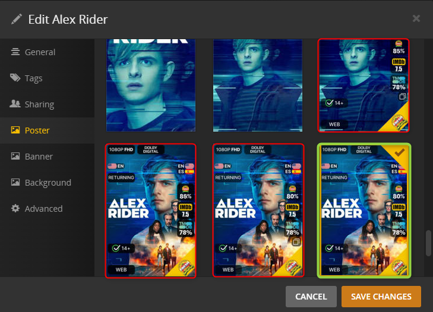

---
hide:
  - toc
---
{%
  include-markdown "https://raw.githubusercontent.com/Kometa-Team/ImageMaid/develop/README.md"
  comments=false
  end=""
  replace='{
    "### Install Walkthroughs": "### Install walkthroughs",
    "### Local Install Overview": "### Local install overview",
    "### Docker Install Overview": "### Docker install overview",
    "#### Docker Run:": "#### Docker run:",
    "## Global Options": "## Global options",
    "### Example .env File": "### Example .env file",
    "### Base Options": "### Base options",
    "#### Plex Path": "#### Plex path",
    "#### Download From Plex API": "#### Download from Plex API",
    "#### Copy From Local": "#### Copy from local",
    "#### Use Existing": "#### Use existing",
    "### Other Operations": "### Other operations",
    "#### Photo Transcoder": "#### Photo transcoder",
    "#### Empty Trash": "#### Empty trash",
    "#### Clean Bundles": "#### Clean bundles",
    "### Other Options": "### Other options",
    "#### Overlays Only": "#### Overlays only",
    "#### Gotify Notifications": "#### Gotify notifications",
    "#### No Verify SSL": "#### No verify SSL",
    "#### Log Requests": "#### Log requests",
    "### Continuous Schedule": "### Continuous schedule",
    "### Schedule Blocks": "### Schedule blocks",
    "#### Schedule Block Parts": "#### Schedule block parts",
    "### Schedule Block Example": "### Schedule block example"
}'
%}

{%
  include-markdown "https://raw.githubusercontent.com/Kometa-Team/ImageMaid/develop/README.md"
  comments=false
  start=""
  replace='{
    "### Install Walkthroughs": "### Install walkthroughs",
    "### Local Install Overview": "### Local install overview",
    "### Docker Install Overview": "### Docker install overview",
    "#### Docker Run:": "#### Docker run:",
    "## Global Options": "## Global options",
    "### Example .env File": "### Example .env file",
    "### Base Options": "### Base options",
    "#### Plex Path": "#### Plex path",
    "#### Download From Plex API": "#### Download from Plex API",
    "#### Copy From Local": "#### Copy from local",
    "#### Use Existing": "#### Use existing",
    "### Other Operations": "### Other operations",
    "#### Photo Transcoder": "#### Photo transcoder",
    "#### Empty Trash": "#### Empty trash",
    "#### Clean Bundles": "#### Clean bundles",
    "### Other Options": "### Other options",
    "#### Overlays Only": "#### Overlays only",
    "#### Gotify Notifications": "#### Gotify notifications",
    "#### No Verify SSL": "#### No verify SSL",
    "#### Log Requests": "#### Log requests",
    "### Continuous Schedule": "### Continuous schedule",
    "### Schedule Blocks": "### Schedule blocks",
    "#### Schedule Block Parts": "#### Schedule block parts",
    "### Schedule Block Example": "### Schedule block example"
}'
%}
