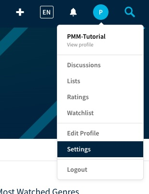
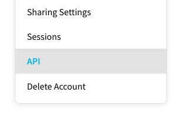
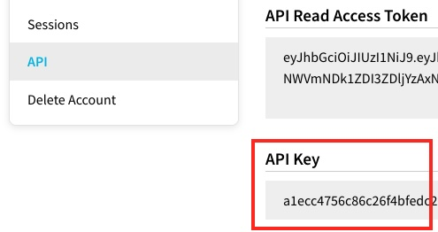

<span id="local-local-walkthrough"></span>
<span id="local-prepare-a-small-test-library-optional"></span>
<span id="local-create-a-directory-to-quiet-an-error-later"></span>
<span id="local-setting-up-the-initial-config-file"></span>
<span id="local-getting-a-tmdb-api-key"></span>
<span id="local-getting-a-plex-url-and-token"></span>
<span id="local-editing-the-config-file"></span>
<span id="local-testing-the-config-file"></span>

<span id="docker-docker-walkthrough"></span>
<span id="docker-prepare-a-small-test-library-optional"></span>
<span id="docker-create-a-directory-to-quiet-an-error-later"></span>
<span id="docker-setting-up-the-initial-config-file"></span>
<span id="docker-getting-a-tmdb-api-key"></span>
<span id="docker-getting-a-plex-url-and-token"></span>
<span id="docker-editing-the-config-file"></span>
<span id="docker-testing-the-config-file"></span>

<span id="unraid-unraid-walkthrough"></span>
<span id="unraid-prepare-a-small-test-library-optional"></span>
<span id="unraid-create-a-directory-to-quiet-an-error-later"></span>
<span id="unraid-setting-up-the-initial-config-file"></span>
<span id="unraid-getting-a-tmdb-api-key"></span>
<span id="unraid-getting-a-plex-url-and-token"></span>
<span id="unraid-editing-the-config-file"></span>
<span id="unraid-testing-the-config-file"></span>

## Configure Kometa {#configuration}

Kometa runs from the command line and reads YAML files. It can run on a different machine from Plex, as long as it can reach Plex over the network. It does not need access to your media files.

Gather your Plex server URL, Plex token, and TMDb API key. Keep tokens in your own configuration file; this page does not collect them.

#### Getting a TMDb API key

Note that if you already have an API key, you can use that one. You don’t need another.

Go to [https://www.themoviedb.org/](https://www.themoviedb.org/). 
Log into your account [or create one if you don’t have one already], then go to “Settings” under your account menu.



In the sidebar menu on the left, select “API”.



Click to generate a new API key under "Request an API Key". If there is already one there, copy it and go to the next step.

There will be a form to fill out; the answers are arbitrary. The URL can be your personal website, or probably even google.com or the like.

Once you’ve done that there should be an API Key available on this screen. If you see v3 and v4, you want the v3 key.



Copy that value, you’ll need it for the config file.

#### Getting a Plex URL and token

The Plex URL is whatever URL you’d use **from this machine** to connect directly to your Plex server [i.e. NOT app.plex.tv].

As with the TMDb API Key, if you already have a Plex Token, you can use that one.

This article will describe how to get a token: [Finding an authentication token](https://support.plex.tv/articles/204059436-finding-an-authentication-token-x-plex-token/)


### Create your configuration {#minimal-configyml}

<div data-method="local" markdown="1">

Save `config.yml` inside the `config` directory in your Kometa checkout. Create an `assets` subdirectory there too.

</div>

<div data-env="windows macos linux unraid qnap synology truenas" data-method="docker nas" markdown="1">

Save `config.yml` in the host directory mapped to `/config`; inside the container it must appear as `/config/config.yml`. Create an `assets` subdirectory in that host directory too.

</div>

Use a plain text editor and two spaces for YAML indentation. Replace the four placeholders below, including the library name with its exact name in Plex. For a TV library, use the name of that library instead.

<div data-env="kubernetes" markdown="1">

Put these settings in the Kometa ConfigMap shown above and apply it before starting a Job. Keep the collection-file ConfigMaps consistent with the paths referenced in that configuration. The ConfigMap is mounted read-only; edit and reapply it to change settings rather than editing it inside a Pod.

</div>

Here's the absolute minimum `config.yml` file you need to get started:

```yaml
libraries:
  NAME_OF_YOUR_MOVIE_LIBRARY:
    collection_files:
      - default: basic
 
plex:
  url: YOUR_PLEX_URL
  token: YOUR_PLEX_TOKEN

tmdb:
  apikey: YOUR_TMDB_API_KEY
```

Change those four UPPER_CASE items to your actual values, and you're good to go. Running that file will create a couple of collections in your Plex movie library.

Kometa will *also* fill in that file with a lot of defaults, ready for you to modify and expand as you learn more about Kometa.
It does this so that as new settings are added, the default values are inserted into your config file, ready for you to modify.

Once you have Kometa set up and are actively making changes, most of your changes will happen under the `libraries` section of the config file. *Most*. **Not** "all", **most**. 
There are of course changes you can and may want to do elsewhere to support your requirements, but the vast majority of your work will be in the `libraries` section.


### Run and verify {#first-run}

Save your configuration, then run Kometa using the instructions below. Wait for any active Kometa run to finish before starting another run against the same configuration. A container waiting for its next scheduled run can remain running while you use its console.

<div data-method="local" markdown="1">

From your Kometa checkout with the virtual environment activated:

```shell
python kometa.py --run
```

</div>

<div data-method="docker" data-launch="run" markdown="1">

Replace `FULL_PATH_TO_CONFIG` with the full host path of the directory containing `config.yml`:

```shell
docker run --rm -it -v "FULL_PATH_TO_CONFIG:/config:rw" kometateam/kometa --run
```

</div>

<div data-method="docker" data-launch="compose" markdown="1">

From the directory containing `compose.yml`:

```shell
docker compose run --rm kometa --run
```

</div>

<div data-env="unraid qnap synology truenas" markdown="1">

Use your platform's container console to run the following inside the Kometa container. The host configuration directory must be mounted at `/config`:

```shell
python kometa.py --run
```

If the container exits immediately, create and save `config.yml` in its host configuration directory first, then start the container and reopen its console. For TrueNAS you can also use the one-shot Docker command shown in its setup steps.

</div>

<div data-env="kubernetes" markdown="1">

Apply the manifests from the Kubernetes instructions, then trigger the CronJob manually. Substitute the namespace and CronJob name from your manifest:

```shell
kubectl -n YOUR_NAMESPACE create job --from=cronjob/YOUR_CRONJOB_NAME kometa-first-run
kubectl -n YOUR_NAMESPACE logs -f job/kometa-first-run
```

Use a fresh Job name when repeating this check.

</div>

Look for successful TMDb and Plex connections, your library being processed, and a completed run. Check Plex for the collections created by the `basic` default. If connections fail, check your credentials, the exact library name, and whether Plex is reachable from the selected environment. See [help and logs](../help.md#find-and-read-your-logs).

<span id="local-creating-a-few-sample-collections"></span>
<span id="local-adding-overlays-to-movies"></span>

<span id="docker-creating-a-few-sample-collections"></span>
<span id="docker-adding-overlays-to-movies"></span>

<span id="unraid-creating-a-few-sample-collections"></span>
<span id="unraid-adding-overlays-to-movies"></span>

## Optional examples {#examples}

Add one feature at a time and rerun Kometa to check the result. Use a small test library first, especially when trying overlays.

<details markdown="1"><summary>Add more default collections</summary>

Under your existing library, add another default:

```yaml
libraries:
  YOUR_LIBRARY_NAME:
    collection_files:
      - default: basic
      - default: imdb
```

Save and rerun using the same command as your first run. Browse [collection defaults](../../defaults/collections/usage.md) for additional choices.

</details>

<details markdown="1"><summary>Create a custom collection file</summary>

Save `collections.yml` alongside `config.yml`:

```yaml
collections:
  My favourites:
    plex_search:
      all:
        title: Star Wars
```

Add it under your library's `collection_files`:

<div data-method="local" markdown="1">

```yaml
    collection_files:
      - default: basic
      - file: config/collections.yml
```

</div>

<div data-method="docker nas" markdown="1">

```yaml
    collection_files:
      - default: basic
      - file: /config/collections.yml
```

</div>

<div data-env="kubernetes" markdown="1">

Mount the file from a ConfigMap as shown in the platform instructions.

</div>

Rerun and look for the new collection. See [collection files](../../files/collections.md) for more builders and settings.

</details>

<details markdown="1"><summary>Try an overlay</summary>

Add `overlay_files` under the same library, alongside `collection_files`:

```yaml
    overlay_files:
      - default: resolution
```

Rerun Kometa and inspect the posters in Plex. Read the [overlay guide](../guides/overlays.md) before expanding or removing overlays.

</details>

<span id="local-what-comes-next"></span>
<span id="local-runtime-and-environment-flags"></span>
<span id="local-creating-collections-overlays-playlists-etc"></span>
<span id="local-other-topics"></span>
<span id="local-scheduling"></span>
<span id="local-i-want-to-update-to-the-latest-version-of-the-current-kometa-branch"></span>
<span id="local-i-want-to-use-the-develop-branch"></span>
<span id="local-i-want-to-use-the-master-branch"></span>

<span id="docker-what-comes-next"></span>
<span id="docker-runtime-and-environment-flags"></span>
<span id="docker-creating-collections-overlays-playlists-etc"></span>
<span id="docker-other-topics"></span>
<span id="docker-scheduling"></span>
<span id="docker-i-want-to-use-the-develop-branch"></span>
<span id="docker-i-want-to-use-the-master-branch"></span>

<span id="unraid-what-comes-next"></span>
<span id="unraid-runtime-and-environment-flags"></span>
<span id="unraid-creating-collections-overlays-playlists-etc"></span>
<span id="unraid-other-topics"></span>
<span id="unraid-scheduling"></span>
<span id="unraid-i-want-to-use-the-develop-branch"></span>
<span id="unraid-i-want-to-use-the-master-branch"></span>

## Scheduling and updates {#maintenance}

A normal Kometa process without `--run` waits for its scheduled run, by default at 05:00. Configure your desired schedule using [commands and environment variables](../environmental.md). Kubernetes uses the CronJob schedule in its manifest. Avoid scheduling the same configuration in more than one place.

<div data-method="local" markdown="1">

To update a local installation, activate the virtual environment, run `git pull`, and install the current requirements with `python -m pip install -r requirements.txt`.

</div>

<div data-method="docker" data-launch="run" markdown="1">

To update Docker Run, pull the image before the next run with `docker pull kometateam/kometa`.

</div>

<div data-method="docker" data-launch="compose" markdown="1">

To update Compose, use `docker compose pull` and recreate the scheduled service with `docker compose up -d`.

</div>

<div data-env="unraid qnap synology truenas" markdown="1">

Use your platform's image update and container recreation controls, preserving the `/config` mount.

</div>

<div data-env="kubernetes" markdown="1">

To update Kubernetes, update the image in the CronJob manifest and apply it; new Jobs use the new image.

</div>

Use the image or code branch matching the wiki version you are reading. See [Docker images](images.md) for supported tags and variants.

Your configuration is portable between environments. Copy its directory, adjust paths and service URLs, and select your new environment above. Continue with [understanding your config and files](files.md), [YAML basics](../yaml.md), and [defaults](../../defaults/guide.md).
