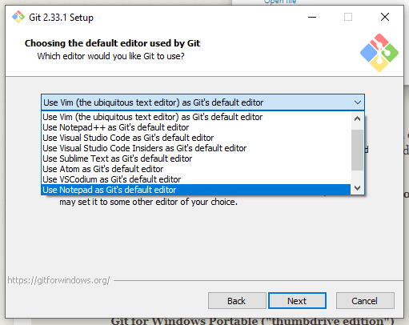

### Prerequisites {#local-prerequisites}

You need access to your Plex server, permission to create and edit configuration files, and a terminal. Use PowerShell on Windows or Terminal on macOS and Linux.

### Install uv {#local-installing-uv}

uv manages Python and Kometa's dependencies for you. Follow the [official uv installation instructions](https://docs.astral.sh/uv/getting-started/installation/), or use the command for your platform below.

<span id="local-installing-python"></span>

<div class="install-variant" data-os="linux" markdown="1">

```shell
curl -LsSf https://astral.sh/uv/install.sh | sh
```

</div>

<div class="install-variant" data-os="macos" markdown="1">

```shell
curl -LsSf https://astral.sh/uv/install.sh | sh
```

</div>

<div class="install-variant" data-os="windows" markdown="1">

```powershell
powershell -ExecutionPolicy ByPass -c "irm https://astral.sh/uv/install.ps1 | iex"
```

</div>

Open a new terminal after installation, then check:

```shell
uv --version
```

uv can download Python automatically if a compatible interpreter is not available. Kometa requires Python 3.12 or newer; the currently tested versions are 3.12 through 3.14.

---

### Installing Git {#local-installing-git}

To copy the Kometa code to your machine, we'll be using git. This may be installed on Mac or Linux, and probably isn't in Windows.

Let's check if Git is already installed [type this into your terminal]

```shell
git --version
```

If this doesn't return a version number, you'll need to get git installed.


<div class="install-variant" data-os="linux" markdown="1">

The git install is discussed here: [Download for Linux and Unix](https://git-scm.com/downloads/linux)


</div>


<div class="install-variant" data-os="macos" markdown="1">

The git install is discussed here: [Git - Downloading Package](https://git-scm.com/downloads/mac)


</div>


<div class="install-variant" data-os="windows" markdown="1">

Download the installer from [here](https://git-scm.com/downloads/win)

Run the install; you can probably just accept the defaults and click through except for the step that asks you to choose an editor; 
you probably want to choose something other than the default there:



This install comes with its own command line interface. **Do not use this interface in this walkthrough**. Continue to do everything here in Powershell.


</div>

---

### Retrieving the Kometa code {#local-retrieving-the-kometa-code}

Now we're going to use `git` to make a copy of the code on your local computer in the home directory [type this into your terminal]

```shell
cd ~
git clone https://github.com/Kometa-Team/Kometa
cd Kometa
```

Now `git checkout` to the branch reflecting the version of the wiki you are reading, as some functionality may be dependent on this. 
**If you are reading the latest version of the wiki, no `git checkout` is required.**


<div class="install-variant" data-release="latest" markdown="1">

**:fontawesome-brands-github: latest**


If you are reading the latest version of the wiki, no `git checkout` is required.


</div>


<div class="install-variant" data-release="develop" markdown="1">

**:fontawesome-brands-github: develop**


```shell
git checkout develop
```


</div>

???+ tip "Important Information"

    The rest of this walkthrough assumes you are staying in this directory in this terminal/Powershell window.

    **In the future, when you want to run Kometa at the command line, you have to be in this directory.**

#### Navigating to the Kometa code {#local-navigating-to-the-kometa-code}

When you open a command window to run Kometa, the first step will always be:

```shell
cd ~
cd Kometa
```

There are parts of the code that are assuming and expecting that you will be in this directory when you run Kometa [the fonts used in overlays are one example]. 
Be sure that you are always in this directory when you run Kometa.

??? question "What did that do?"

    ```shell
    cd ~
    ```

    This changes to your home directory, which will be something like `/home/yourname` or `/Users/yourname` or `C:\Users\YourName` depending on the platform.

    ```shell
    git clone https://github.com/Kometa-Team/Kometa
    ```

    This uses `git` to make a copy of (`clone`) the Kometa code from where it is stored on `github`.

    ```shell
    cd Kometa
    ```

    This moves into the directory that was created by the `clone` command.


Later on you can move it elsewhere if you want, but for now put it there. This will ensure that everything to follow works just like it says here. 
Presumably you’re reading this because the other docs are unclear to you. Use the example directory layout to follow the commands consistently.

??? question "Why use git instead of downloading the release ZIP?"

    Retrieving the code with `git` makes updating simpler. When you want to update to the newest version, you can go into this directory and type:

    ```shell
    git pull
    ```

    No need to download a new ZIP, decompress it, etc.

    Also, if you are asked to [or want to] switch to the latest develop code, you can do so with:

    ```shell
    git checkout develop
    ```

---

<span id="local-setting-up-a-virtual-environment"></span>
<span id="local-installing-requirements"></span>

### Install Kometa's dependencies {#local-sync-dependencies}

From the Kometa directory, run:

```shell
uv sync
```

This creates a `.venv` directory and installs the dependencies recorded in `uv.lock`. uv manages that environment automatically whenever you use `uv run`.

!!! tip "Choosing a Python version"

    If your installed Python is newer than the tested versions, use `uv sync --python 3.14` to select Python 3.14 for this environment. uv downloads it if needed.

If you already use an older `kometa-venv` installation, open a new terminal and run `uv sync` from your checkout. Keep your existing `config` directory and use the `uv run` commands below for future runs. Update any scheduled tasks to match the [scheduling guide](../guides/scheduling.md).

### Verify install and create config template {#local-verify-install-and-create-config-template}

From the Kometa directory, run:

```shell
uv run python kometa.py --run
```

On a new installation, Kometa creates `config/config.yml` and asks you to add your API keys and other settings. Continue to [Configure Kometa](#configuration), then [Run and verify](#first-run).

Use `uv run python kometa.py` whenever you start Kometa, adding flags such as `--run` as needed. Run it from the checkout directory so Kometa can find its files. See [uv's project guide](https://docs.astral.sh/uv/guides/projects/) for more about managed environments.
